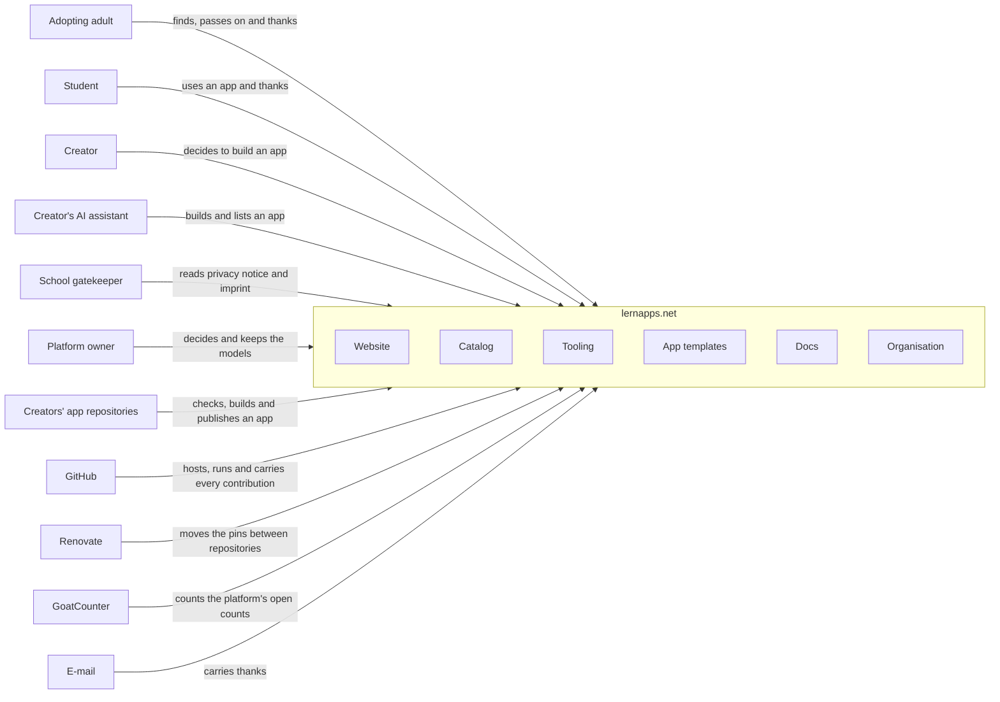

# System Scope and Context

The system is lernapps.net with all repositories of the organisation (chapter 5). The people come from the platform
model's entities ([E2](https://lernapps.net/docs/platform-design/#1-exploration/e2-scan.pdt42.md), [D1](https://lernapps.net/docs/platform-design/#2-design/d1-ecosystem.pdt42.md), [KD-10](https://github.com/lernapps/docs/blob/main/.vibe/development-plan-feat-platform-design.md#kd-10-six-peer-roles-github-as-means-of-production-d1)). The learning apps' own repositories are outside: the system meets them through their
GitHub Actions. Teacher platforms and social media only pass links on and have no technical interface; they are left
out.

## Context

```arc42
:::diagram
id: context-overall
view: context
notation: mermaid
:::
```



## Adopting adult

A teacher who takes over a class at short notice, or a parent whose child struggles with a topic, the platform's [core entity](https://lernapps.net/docs/platform-design/#1-exploration/e2-scan.pdt42.md:el-e-adopters) ([KD-13](https://github.com/lernapps/docs/blob/main/.vibe/development-plan-feat-platform-design.md#kd-13-core-triangle-adopting-adults-first-d4)).
They find an app for a topic and grade, pass it on by link or QR code, and say thanks.

```arc42
:::actor
id: actor-adopting-adult
title: Adopting adult
type: person
description: Teachers and parents (pdt42 e-adopters) who find, pass on and thank
requires: if-catalog-pages, if-served-apps, if-thanks, if-home-pages
:::
```

## Student

[A learner](https://lernapps.net/docs/platform-design/#1-exploration/e2-scan.pdt42.md:el-e-students) who opens an app from a link or QR code, or finds one for a topic they struggle with. Students never sign up.

```arc42
:::actor
id: actor-student
title: Student
type: person
description: Learners (pdt42 e-students) who use an app and may say thanks
requires: if-served-apps, if-thanks, if-catalog-pages
:::
```

## Creator

[A person who builds an app](https://lernapps.net/docs/platform-design/#1-exploration/e2-scan.pdt42.md:el-e-creators), often for their own class. They decide to build when the catalog has no
fitting app, and work through their AI assistant.

```arc42
:::actor
id: actor-creator
title: Creator
type: person
description: App creators (pdt42 e-creators); they build and list through their AI assistant
requires: if-home-pages, if-catalog-pages
:::
```

## Creator's AI assistant

[The assistant](https://lernapps.net/docs/platform-design/#1-exploration/e2-scan.pdt42.md:el-e-ai-assistants) a creator builds and lists an app with ([KD-10](https://github.com/lernapps/docs/blob/main/.vibe/development-plan-feat-platform-design.md#kd-10-six-peer-roles-github-as-means-of-production-d1), [KD-11](https://github.com/lernapps/docs/blob/main/.vibe/development-plan-feat-platform-design.md#kd-11-portraits-of-the-six-peer-roles-d2)). It reads the guidance, runs the
tooling, and opens the listing pull request.

```arc42
:::actor
id: actor-ai-assistant
title: Creator's AI assistant
type: system
description: The AI tool a creator builds and lists an app with; it reads the guidance and runs the CLI (pdt42 e-ai-assistants)
requires: if-guidance, if-tooling-cli, if-listing, if-home-pages
:::
```

## School gatekeeper

[A school's data protection officer or head](https://lernapps.net/docs/platform-design/#1-exploration/e2-scan.pdt42.md:el-e-gatekeepers) who decides whether an app may be used. They read who
provides the app and what it does with data.

```arc42
:::actor
id: actor-gatekeeper
title: School gatekeeper
type: person
description: Data protection officers and heads of school (pdt42 e-gatekeepers)
requires: if-home-pages
:::
```

## Platform owner

Oliver Jägle, who [owns and runs the platform](https://lernapps.net/docs/platform-design/#1-exploration/e2-scan.pdt42.md:el-e-platform-owner) alone today ([KD-09](https://github.com/lernapps/docs/blob/main/.vibe/development-plan-feat-platform-design.md#kd-09-oliver-jägle-alone-owns-the-platform-2026-09-30)). He decides and keeps the models of the
platform. The system itself needs no step of his; what still waits on him is recorded as a gap at the interface
concerned, with the risk it carries (`risk-one-owner`).

```arc42
:::actor
id: actor-platform-owner
title: Platform owner
type: person
description: Oliver Jägle (pdt42 e-platform-owner)
requires: if-listing, if-org-rules, if-models
:::
```

## Creators' app repositories

Every learning app lives in a repository of its own, which belongs to its creator and is outside the system. Their GitHub Actions run the tooling's
workflows to check, build and publish an app, and the platform passes its changes on to them as pull requests;
this is where the system meets them. If this boundary needs more
detail, it is refined in the tooling's architecture, not here.

```arc42
:::actor
id: actor-app-repo-actions
title: Creators' app repositories
type: system
description: The creators' own app repositories, whose workflows use the tooling's actions
requires: if-app-actions, if-tooling-cli
:::
```

## GitHub

The platform's means of production ([KD-10](https://github.com/lernapps/docs/blob/main/.vibe/development-plan-feat-platform-design.md#kd-10-six-peer-roles-github-as-means-of-production-d1)): repositories, issues and pull requests carry every contribution, Actions
run every check and publication, Pages serves every site and every app copy.

```arc42
:::actor
id: actor-github
title: GitHub
type: system
description: Repositories, issues, pull requests, Actions and Pages
requires: if-listing, if-app-actions, if-org-rules
:::
```

## Renovate

Renovate keeps the pins between the repositories current: when the site frame, the tooling or
the archetypes change, it passes the change on as a pull request in every repository that uses them.

```arc42
:::actor
id: actor-renovate
title: Renovate
type: system
description: Dependency update service that keeps the versions the repositories use up to date
requires: if-site-frame, if-tooling-cli, if-archetypes
:::
```

## GoatCounter

The external service that counts on the platform's own pages, openly and only as totals (`con-open-counting`). The
apps never use it. The site frame carries the counting.

```arc42
:::actor
id: actor-goatcounter
title: GoatCounter
type: system
description: Hosted counting service for the platform's own pages
requires: if-site-frame
:::
```

## E-mail

The realisation of the thanks behind `if-thanks`: the catalog prepares an e-mail. The interface stays when the
realisation changes.

```arc42
:::actor
id: actor-email
title: E-mail
type: system
description: Mail system that carries thanks and feedback
requires: if-thanks
:::
```
