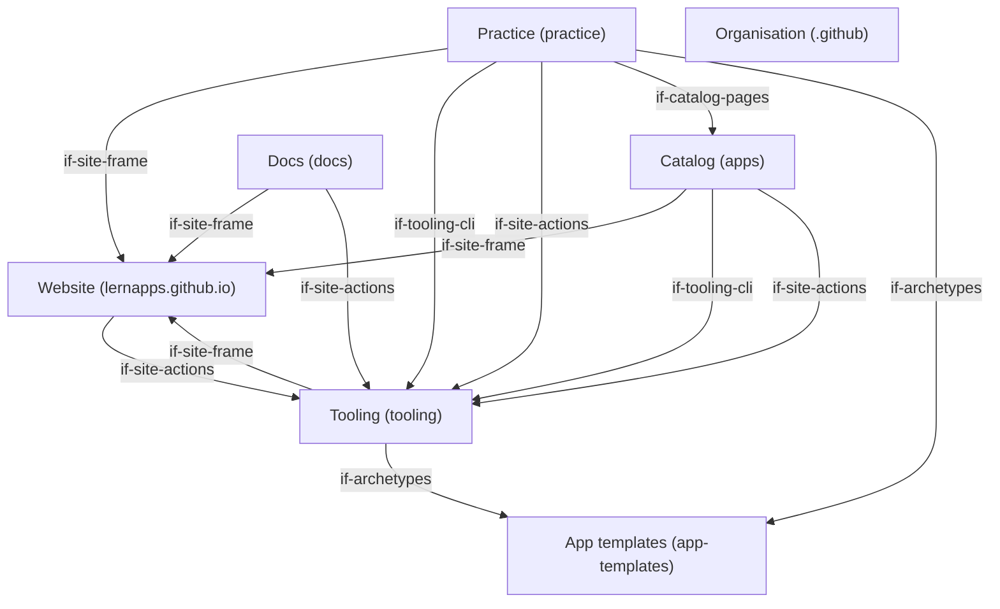

# Building Blocks

The platform is built from one building block per repository of the organisation, each with a job of its own. The
learning apps' repositories are outside the system (chapter 3). This is level 1: each block stays a black box here;
where a block has an architecture of its own, that architecture refines it. This chapter names each block's job, the
interfaces it provides and those it requires.

## Level 1

```arc42
:::diagram
id: building-blocks-level-1
view: building-block
notation: mermaid
:::
```



## Website

Gives the platform its face at lernapps.net and the frame every platform site is built with. The home page tells the
platform's story in plain language ([KD-20](https://github.com/lernapps/docs/blob/main/.vibe/development-plan-feat-platform-design.md#kd-20-idealistic-free-possibly-a-verein-later)); the privacy notice and the imprint cover every served app ([KD-21](https://github.com/lernapps/docs/blob/main/.vibe/development-plan-feat-platform-design.md#kd-21-lernappsnet-serves-a-copy-of-every-listed-app-lernappsapps58-2026-10-20)); llms.txt
is the entry point for AI assistants. The frame is the shared header and footer and site-check, the checks every site
has to pass before it is published.

```arc42
:::ignore H014 implemented in another repository, lernapps/lernapps.github.io: https://github.com/lernapps/lernapps.github.io :::
:::building-block
id: bb-website
implements: concept-one-origin, concept-privacy-by-construction, concept-checked-not-declared, concept-assistants-as-readers, concept-plain-language, concept-pinned-and-pulled, concept-change-scope, concept-why-in-history
title: Website
technology: Eleventy, GitHub Pages
x-repo: lernapps/lernapps.github.io
requires: if-site-actions
:::
```

### Home pages

The home page, the privacy notice and the imprint, and the root `llms.txt` that leads AI assistants to the other
parts of the platform. The privacy notice is part of the signal that an app may be used: it covers every app served
under lernapps.net.

```arc42
:::ignore H014 implemented in another repository, lernapps/lernapps.github.io: https://github.com/lernapps/lernapps.github.io :::
:::interface
id: if-home-pages
title: Home pages
provider: bb-website
protocol: HTTPS pages and llms.txt under lernapps.net
x-realises: ch-guidance, ch-fitness-signal
:::
```

### Site frame

The shared header, footer, styles and counting snippet of every platform site, and `site-check`, the check every
site runs on its built pages before it is deployed. The counting snippet reports visits to GoatCounter; this is
where a creator's insight into the use of their app begins.

```arc42
:::ignore H014 implemented in another repository, lernapps/lernapps.github.io: https://github.com/lernapps/lernapps.github.io :::
:::interface
id: if-site-frame
title: Site frame
provider: bb-website
protocol: npm package @lernapps/site from git, pinned to a commit
x-realises: ch-creator-insight
x-missing-ch-creator-insight: Only visits to an app's page in the catalog are counted, not the use of the app itself, and only the platform owner sees the totals.
:::
```

## Catalog

Lets adults and students find, trust and start apps, and lets creators list them; it is the core of the platform. For adults and students, it makes [apps findable by topic and grade](https://lernapps.net/docs/platform-design/#2-design/d6-learning-engine.pdt42.md:el-s-finding), serves a copy of
every listed app under lernapps.net and keeps it current ([KD-21](https://github.com/lernapps/docs/blob/main/.vibe/development-plan-feat-platform-design.md#kd-21-lernappsnet-serves-a-copy-of-every-listed-app-lernappsapps58-2026-10-20)), and takes [the thanks of adults and students](https://lernapps.net/docs/platform-design/#2-design/d6-learning-engine.pdt42.md:el-s-giving-back). For creators, it
[takes their entries](https://lernapps.net/docs/platform-design/#2-design/d5-transactions.pdt42.md:el-t-list-app) and [helps them list](https://lernapps.net/docs/platform-design/#2-design/d6-learning-engine.pdt42.md:el-s-listing-help); it [checks each entry and has a review agent look at the app](https://lernapps.net/docs/platform-design/#2-design/d6-learning-engine.pdt42.md:el-s-fitness-clarity), and publishes the copy once the checks pass.

```arc42
:::ignore H014 implemented in another repository, lernapps/apps: https://github.com/lernapps/apps :::
:::building-block
id: bb-catalog
implements: concept-one-origin, concept-privacy-by-construction, concept-checked-not-declared, concept-assistants-as-readers, concept-plain-language, concept-pinned-and-pulled, concept-change-scope, concept-why-in-history
title: Catalog
technology: Eleventy, GitHub Actions, GitHub Pages
requires: if-site-frame, if-tooling-cli, if-site-actions
x-repo: lernapps/apps
:::
```

### Catalog pages

The pages where adults and students find an app for a topic and grade, see its fitness for use, and find the way to
build an app when none fits.

```arc42
:::ignore H014 implemented in another repository, lernapps/apps: https://github.com/lernapps/apps :::
:::interface
id: if-catalog-pages
title: Catalog pages
provider: bb-catalog
protocol: HTTPS pages under lernapps.net/apps/
x-realises: ch-app-overview, ch-fitness-signal
:::
```

### Served apps

The copy of every listed app that lernapps.net serves and links: built from the release the creator publishes at
their own address, and served under one address that keeps working.

```arc42
:::ignore H014 implemented in another repository, lernapps/apps: https://github.com/lernapps/apps :::
:::interface
id: if-served-apps
title: Served apps
provider: bb-catalog
protocol: HTTPS under lernapps.net/apps/start/<id>/
x-realises: ch-direct-start
:::
```

### Listing

How a creator, through their AI assistant, lists an app: an entry by pull request, checked automatically (what the app sends to third parties and keeps in the browser, whether
its links and topics hold, and that its licence allows the copy) and by a review agent, an AI that checks the app against a checklist, with the result as a comment on the pull request. Once the checks pass, the copy is published; no person has to act. What still waits on the platform owner is recorded as a gap of this interface, with the risk it carries (`risk-one-owner`).

```arc42
:::ignore H014 implemented in another repository, lernapps/apps: https://github.com/lernapps/apps :::
:::interface
id: if-listing
title: Listing
provider: bb-catalog
protocol: GitHub pull request with an entry file; results comment
x-realises: ch-listing, ch-fitness-signal
x-missing-ch-listing: A listing is published only after the platform owner approves the pull request, and the review agent runs only at their request.
x-risk: risk-one-owner
:::
```

### Thanks

A thank-you and feedback in one click from the catalog or an app, counted openly and passed on to the creator. The
interface stays the same when its realisation changes. No person has to act for thanks to arrive. What still waits
on the platform owner is recorded as a gap of this interface, with the risk it carries (`risk-one-owner`).

```arc42
:::ignore H014 implemented in another repository, lernapps/apps: https://github.com/lernapps/apps :::
:::interface
id: if-thanks
title: Thanks
provider: bb-catalog
protocol: link from the catalog or an app; realised as a prepared e-mail
x-realises: ch-feedback, ch-creator-insight
x-missing-ch-feedback: A click opens a prepared e-mail from the sender's own account; thanks and feedback arrive, but they are neither anonymous nor counted, and recommendations are not recorded.
x-missing-ch-creator-insight: Thanks reach the creator only if the platform owner passes them on.
x-risk: risk-one-owner
:::
```

## Tooling

Gives a creator's AI assistant everything it needs to [build an app that meets the platform's rules](https://lernapps.net/docs/platform-design/#2-design/d6-learning-engine.pdt42.md:el-s-building-guidance):
the guidance by phase and the skills, the CLI that creates an app and checks it, and the workflows an app's
repository runs. It also holds the actions that build every platform site and publish it once site-check has passed.

Its own architecture refines this block: [tooling, chapter 5](https://github.com/lernapps/tooling/blob/main/docs/arc42/05-building-blocks.arc42.md).

```arc42
:::ignore H014 implemented in another repository, lernapps/tooling: https://github.com/lernapps/tooling :::
:::building-block
id: bb-tooling
implements: concept-one-origin, concept-checked-not-declared, concept-assistants-as-readers, concept-plain-language, concept-pinned-and-pulled, concept-change-scope, concept-why-in-history
title: Tooling
technology: TypeScript, Node.js, GitHub Actions
requires: if-site-frame, if-archetypes
x-repo: lernapps/tooling
:::
```

### Guidance

The guidance by phase, the skills and the documentation that AI assistants read to build and list an app.

```arc42
:::ignore H014 implemented in another repository, lernapps/tooling: https://github.com/lernapps/tooling :::
:::interface
id: if-guidance
title: Guidance
provider: bb-tooling
protocol: Markdown skills and pages, llms.txt under lernapps.net/tooling/
x-realises: ch-guidance
:::
```

### Tooling CLI

The command line an assistant and the workflows run: create an app from an archetype, check it against the rules,
update it.

```arc42
:::ignore H014 implemented in another repository, lernapps/tooling: https://github.com/lernapps/tooling :::
:::interface
id: if-tooling-cli
title: Tooling CLI
provider: bb-tooling
protocol: npm package @lernapps/tooling from git, pinned to a commit
x-realises: ch-guidance
:::
```

### Site actions

The actions every platform site is built, checked and deployed with, and the previews of its pull requests: the
website, the catalog, the docs and the tooling's own pages.

```arc42
:::ignore H014 implemented in another repository, lernapps/tooling: https://github.com/lernapps/tooling :::
:::interface
id: if-site-actions
title: Site actions
provider: bb-tooling
protocol: GitHub actions, pinned to a commit
:::
```

### App actions

The reusable workflows and actions an app's repository runs to check and build the app and to publish the
creator's own release, at the creator's address.

```arc42
:::ignore H014 implemented in another repository, lernapps/tooling: https://github.com/lernapps/tooling :::
:::interface
id: if-app-actions
title: App actions
provider: bb-tooling
protocol: GitHub reusable workflows and actions, pinned to a commit
:::
```

## App templates

Provides the three kinds of app, quiz, explainer and interactive app, as templates and runtimes that already keep the
platform's rules. They carry the rules into the code, so a creator does not have to know them.

Its own architecture refines this block:
[app-templates, chapter 5](https://github.com/lernapps/app-templates/blob/main/docs/arc42/05-building-blocks.arc42.md).

```arc42
:::ignore H014 implemented in another repository, lernapps/app-templates: https://github.com/lernapps/app-templates :::
:::building-block
id: bb-app-templates
implements: concept-privacy-by-construction, concept-checked-not-declared, concept-assistants-as-readers, concept-plain-language, concept-pinned-and-pulled, concept-change-scope, concept-why-in-history
title: App templates
technology: TypeScript, Vite, Vue
x-repo: lernapps/app-templates
:::
```

### Archetypes

The template and runtime of each archetype, which the tooling creates apps from and apps build with.

```arc42
:::ignore H014 implemented in another repository, lernapps/app-templates: https://github.com/lernapps/app-templates :::
:::interface
id: if-archetypes
title: Archetypes
provider: bb-app-templates
protocol: git repository at a pinned commit
x-realises: ch-guidance
:::
```

## Practice

Turns content that a family's assistant wrote into a temporary app for one test, and guides that assistant. Its own architecture refines this block: [practice, chapter 5](https://github.com/lernapps/practice/blob/main/docs/arc42/05-building-blocks.arc42.md).

```arc42
:::ignore H014 implemented in another repository, lernapps/practice: https://github.com/lernapps/practice :::
:::building-block
id: bb-practice
implements: concept-one-origin, concept-privacy-by-construction, concept-checked-not-declared, concept-assistants-as-readers, concept-plain-language, concept-pinned-and-pulled
title: Practice
technology: TypeScript, Node.js, GitHub Actions, GitHub Pages
requires: if-site-frame, if-site-actions, if-tooling-cli, if-archetypes, if-catalog-pages
x-repo: lernapps/practice
:::
```

### Practice guidance

The guidance that leads the family's AI assistant, with an `llms.txt`.

```arc42
:::ignore H014 implemented in another repository, lernapps/practice: https://github.com/lernapps/practice :::
:::interface
id: if-practice-guidance
title: Practice guidance
provider: bb-practice
protocol: Markdown pages and llms.txt under lernapps.net/practice/
x-realises: ch-guidance
:::
```

### Submission form

The form through which a parent submits the content.

```arc42
:::ignore H014 implemented in another repository, lernapps/practice: https://github.com/lernapps/practice :::
:::interface
id: if-practice-form
title: Submission form
provider: bb-practice
protocol: Form on GitHub
x-realises: ch-temporary-preview
:::
```

### Preview pages

The temporary app of each submission.

```arc42
:::ignore H014 implemented in another repository, lernapps/practice: https://github.com/lernapps/practice :::
:::interface
id: if-practice-previews
title: Preview pages
provider: bb-practice
protocol: HTTPS pages under lernapps.net/practice/
x-realises: ch-temporary-preview
x-missing-ch-temporary-preview: How a kept preparation becomes an entry of the catalog, with its metadata, is not defined.
:::
```

## Docs

Holds the models of the platform: why it exists, who carries it and how the system is built. They are the platform
design, the business model and the architecture of the whole system, each in a modelling language that people and AI
assistants can read and check, rendered as pages.

```arc42
:::building-block
id: bb-docs
implements: concept-one-origin, concept-assistants-as-readers, concept-plain-language, concept-pinned-and-pulled, concept-change-scope, concept-why-in-history
title: Docs
technology: pdt42, biz42 and arc42 CLIs, GitHub Pages
requires: if-site-frame, if-site-actions
x-repo: lernapps/docs
path: docs
:::
```

### Models

The platform design, the business model and the architecture as pages under lernapps.net/docs/, and a skill that
lets an AI assistant work with the platform design.

```arc42
:::interface
id: if-models
title: Models
provider: bb-docs
protocol: HTTPS pages under lernapps.net/docs/; pdt42, biz42 and arc42 files
path: site
:::
```

## Organisation

Holds the rules and decisions that every repository of the platform follows: the profile, the governance, the
templates for issues and pull requests, and the decision issues.

```arc42
:::ignore H014 implemented in another repository, lernapps/.github: https://github.com/lernapps/.github :::
:::building-block
id: bb-org
implements: concept-plain-language, concept-why-in-history
title: Organisation
technology: GitHub organisation repository
x-repo: lernapps/.github
:::
```

### Organisation rules

The rules, governance and templates every repository of the organisation follows, and the decisions that concern
several repositories.

```arc42
:::ignore H014 implemented in another repository, lernapps/.github: https://github.com/lernapps/.github :::
:::interface
id: if-org-rules
title: Organisation rules
provider: bb-org
protocol: Markdown files and issues in lernapps/.github
:::
```
