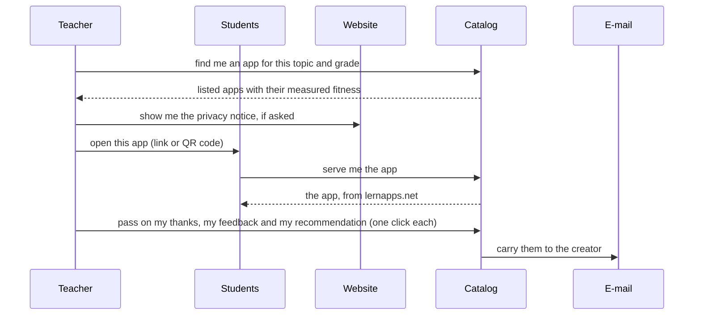
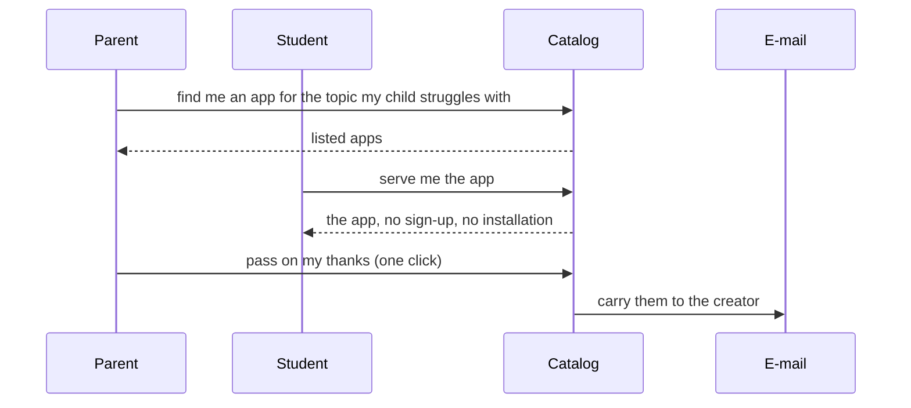
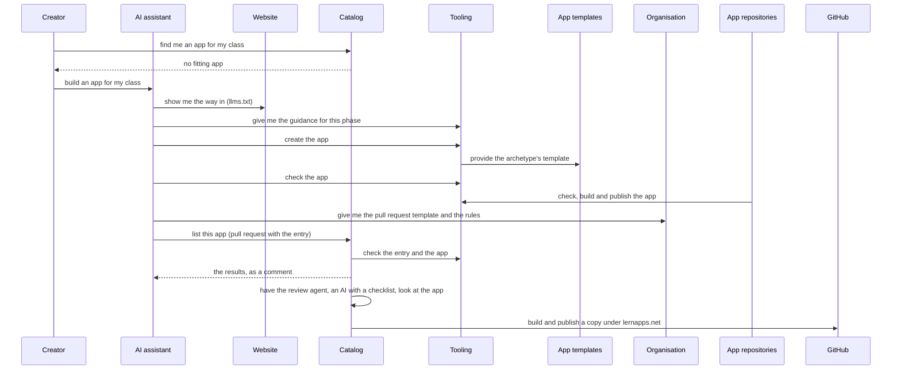
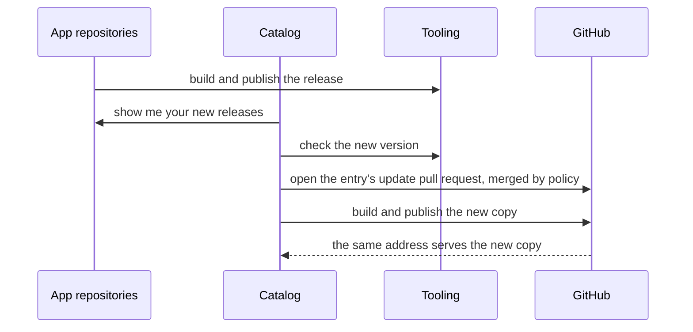
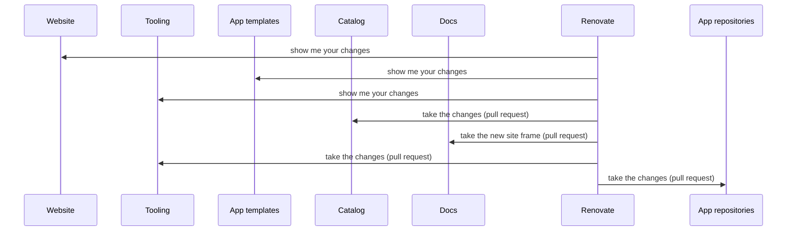
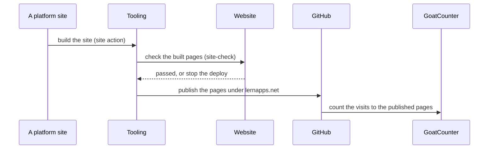

# Runtime View

The [experiences](https://lernapps.net/docs/platform-design/#2-design/d7-experiences.pdt42.md) of the platform model as they run through the system, and the flows behind them that no user sees: how a listed app gets a new version, how the platform passes on its updates and how a platform site is published.
They stop at the building blocks' boundaries; what happens inside the tooling or the app templates is in their own
runtime views, for example how a change of the guidance is measured by the evals
([tooling, chapter 6](https://github.com/lernapps/tooling/blob/main/docs/arc42/06-runtime-view.arc42.md)).

## An app in class within minutes

[A teacher has to take over a class at short notice](https://lernapps.net/docs/platform-design/#2-design/d7-experiences.pdt42.md:el-x-app-in-minutes). They find an app for the topic and grade, see
that it may be used, put it on the projector or pass its link or QR code to the class, and say thanks
afterwards. Everything the class opens is served from lernapps.net.

```arc42
:::runtime-scenario
id: rs-app-in-minutes
title: An app in class within minutes
trigger: A teacher has to take over a class at short notice
involves: bb-catalog, bb-website
x-experience: x-app-in-minutes
:::
```

```arc42
:::diagram
id: rs-app-in-minutes-sequence
scenario: rs-app-in-minutes
notation: mermaid-sequence
aliases: teacher=actor-adopting-adult, student=actor-student, catalog=bb-catalog, website=bb-website, mail=actor-email
:::
```



## Help where a child struggles

[A parent whose child struggles with a topic looks for an app the child can start right away](https://lernapps.net/docs/platform-design/#2-design/d7-experiences.pdt42.md:el-x-child-struggles), or a
student looks for one alone. The flow is the same as in class, without passing the app on.

```arc42
:::runtime-scenario
id: rs-child-struggles
title: Help where a child struggles
trigger: A parent or a student notices a topic the student struggles with
involves: bb-catalog
x-experience: x-child-struggles
:::
```

```arc42
:::diagram
id: rs-child-struggles-sequence
scenario: rs-child-struggles
notation: mermaid-sequence
aliases: parent=actor-adopting-adult, student=actor-student, catalog=bb-catalog, mail=actor-email
:::
```



## Build and list an app

[A creator finds no fitting app and decides to build one](https://lernapps.net/docs/platform-design/#2-design/d7-experiences.pdt42.md:el-x-list-and-hear-back). Their AI assistant follows the
tooling's guidance, creates the app from one of the app templates and checks it; the app's repository runs the
tooling's actions. The assistant opens the listing pull request; the catalog checks the entry, has a review agent look at the app and,
once the checks pass, publishes a copy under lernapps.net. The creator's own release stays at the creator's address;
the copy is what lernapps.net serves.

```arc42
:::runtime-scenario
id: rs-build-and-list
title: Build and list an app
trigger: A creator finds no fitting app in the catalog
involves: bb-website, bb-catalog, bb-tooling, bb-app-templates, bb-org
x-experience: x-list-and-hear-back
:::
```

```arc42
:::diagram
id: rs-build-and-list-sequence
scenario: rs-build-and-list
notation: mermaid-sequence
aliases: creator=actor-creator, assistant=actor-ai-assistant, website=bb-website, catalog=bb-catalog, tooling=bb-tooling, templates=bb-app-templates, org=bb-org, appactions=actor-app-repo-actions, github=actor-github
:::
```



## A listed app gets a new version

The creator releases a new version. The catalog builds a copy from that release and replaces the served copy; the address stays the
same and never stops working (`qs-update-without-gap`).

```arc42
:::runtime-scenario
id: rs-app-update
title: A listed app gets a new version
trigger: A creator releases a new version of a listed app
involves: bb-catalog, bb-tooling
:::
```

```arc42
:::diagram
id: rs-app-update-sequence
scenario: rs-app-update
notation: mermaid-sequence
aliases: appactions=actor-app-repo-actions, catalog=bb-catalog, tooling=bb-tooling, github=actor-github
:::
```



## The platform passes on its updates

When the site frame, the tooling or the app templates change, the platform passes the change on to every
repository that uses them, the creators' apps included: Renovate, an update service, opens a pull request in each
one, and it is merged when the checks pass. Every change of the guidance has been measured by the evals before it is passed on.

```arc42
:::runtime-scenario
id: rs-block-update
title: The platform passes on its updates
trigger: The site frame, the tooling or the app templates change
involves: bb-website, bb-tooling, bb-app-templates, bb-catalog, bb-docs
:::
```

```arc42
:::diagram
id: rs-block-update-sequence
scenario: rs-block-update
notation: mermaid-sequence
aliases: website=bb-website, tooling=bb-tooling, templates=bb-app-templates, catalog=bb-catalog, docs=bb-docs, renovate=actor-renovate, apps=actor-app-repo-actions
:::
```



## A platform site is published

A change is merged to a site's main line: the website, the catalog, the docs or the tooling's pages; the diagram
shows the docs as the example. The tooling's site actions build the site, run `site-check` from the site frame on the built pages, and deploy them to GitHub
Pages under lernapps.net. A failing check stops the deploy.

```arc42
:::runtime-scenario
id: rs-site-published
title: A platform site is published
trigger: A merge to the main line of a platform site
involves: bb-docs, bb-tooling, bb-website
:::
```

```arc42
:::diagram
id: rs-site-published-sequence
scenario: rs-site-published
notation: mermaid-sequence
aliases: docs=bb-docs, tooling=bb-tooling, website=bb-website, github=actor-github, counter=actor-goatcounter
:::
```


